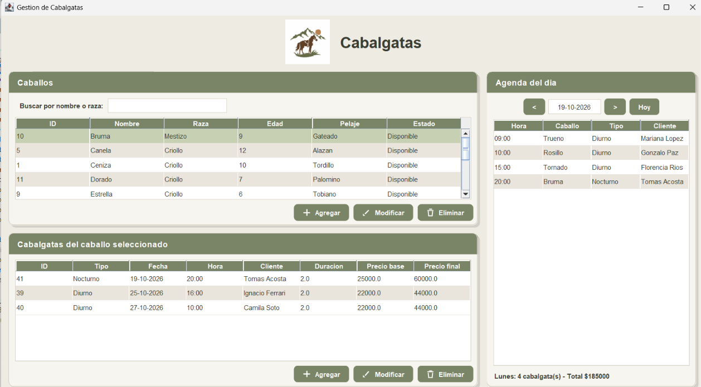
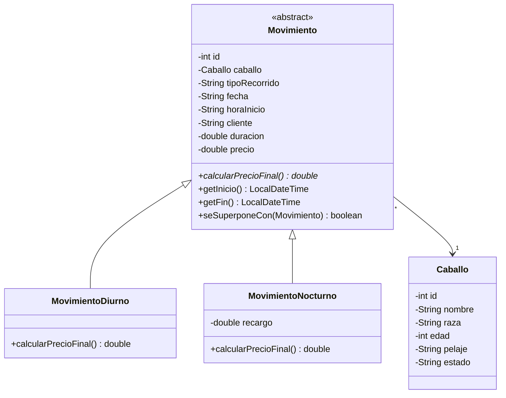
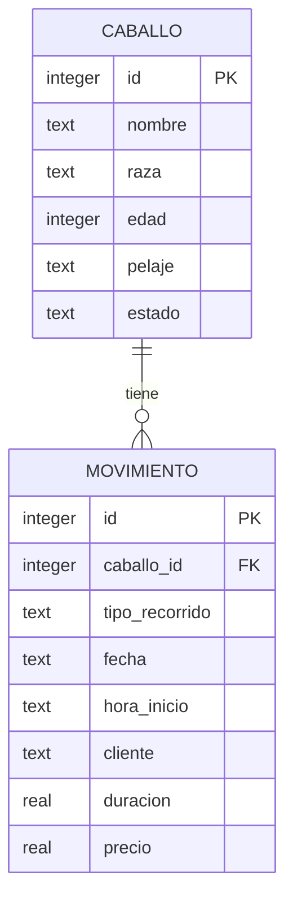

<div align="center">

# 🐎 Cabalgatas

**Sistema de gestión de caballos y cabalgatas para una empresa de turismo ecuestre en Mendoza**


*Trabajo Práctico 2 · Programación III · Universidad Champagnat*

</div>

---

## 📸 Vista previa



## ✨ Qué hace

- **ABM completo** de caballos y de cabalgatas (alta, baja y modificación).
- **Maestro-detalle:** al elegir un caballo se ven automáticamente sus cabalgatas.
- **Buscador** de caballos por nombre o raza, que filtra mientras escribís.
- **Agenda del día:** muestra las cabalgatas de la fecha elegida y el total a cobrar, con botones para ir al día anterior, al siguiente o a hoy.
- **Precio automático:** las cabalgatas diurnas cobran precio × horas; las nocturnas suman un 20% de recargo.
- **Diseño propio** con tarjetas redondeadas, botones con iconos y colores en tonos verdes, centralizado en una clase `Estilo`.

## ✅ Reglas de negocio y validaciones

| Regla | Detalle |
|---|---|
| Sin superposiciones | Un caballo no puede estar en dos cabalgatas a la misma fecha y hora |
| Horarios por tipo | Diurnas de 08:00 a 19:00, nocturnas de 19:00 a 00:00 |
| Caballos en descanso | No se les pueden agendar cabalgatas nuevas |
| Cambio de estado | No se puede pasar a "En descanso" un caballo con cabalgatas a futuro |
| Borrado seguro | No se puede eliminar un caballo que tiene cabalgatas registradas |
| Formatos | Fecha `DD-MM-AAAA`, hora `HH:mm`, cliente obligatorio, duración y precio mayores a 0 |

## 🧱 Arquitectura (MVC)

Cada vista tiene su propio controlador. Las vistas no tienen lógica y **solo los DAO escriben SQL**.

| Capa | Clases | Responsabilidad |
|---|---|---|
| **Modelo** | `Caballo`, `Movimiento`, `MovimientoDiurno`, `MovimientoNocturno`, `Fechas`, `Conexion`, `CaballoDAO`, `MovimientoDAO` | Datos, reglas de precio y acceso a SQLite |
| **Vista** | `VentanaPrincipal`, `CaballoDialog`, `MovimientoDialog`, `Estilo` | Pantallas: muestran datos y exponen botones y campos |
| **Controlador** | `ControladorPrincipal`, `ControladorCaballo`, `ControladorMovimiento`, `ControladorAgenda` | Escuchan los botones, validan, llaman a los DAO y actualizan la vista |

### Programación orientada a objetos



- **Herencia:** `MovimientoDiurno` y `MovimientoNocturno` heredan de la clase abstracta `Movimiento`.
- **Encapsulamiento:** todos los atributos son privados, con getters y setters.
- **Polimorfismo:** `calcularPrecioFinal()` se implementa distinto en cada subclase y se invoca sin saber de qué tipo es cada objeto.

## 🗄️ Base de datos

Dos tablas relacionadas (1 a N): un caballo puede tener muchas cabalgatas.



La base `cabalgatas.db` se crea sola al iniciar el programa. Las fechas se guardan como `AAAA-MM-DD` (para ordenar y filtrar con SQL) y se muestran como `DD-MM-AAAA`.

## 🛠️ Tecnologías

- **Java 23** con **Swing** (`JFrame`, `JDialog`, `JTable`, `JComboBox`, `JCheckBox`)
- **SQLite** con **JDBC** (`sqlite-jdbc 3.46.1.3`, incluido en `lib/`)
- **NetBeans** como entorno de desarrollo

## 📁 Estructura del proyecto

```
Cabalgatas/
├── lib/                      sqlite-jdbc
├── src/
│   ├── cabalgatas/           clase principal (main)
│   ├── modelo/               entidades, DAO, conexión y fechas
│   ├── vista/                ventanas y estilo
│   ├── controlador/          un controlador por vista
│   └── imagenes/             logo
├── captura.png.png           captura de pantalla
└── cabalgatas.db             base de datos SQLite
```

## ▶️ Cómo ejecutarlo

1. Clonar el repositorio o descargar el ZIP.
2. Abrir el proyecto en **NetBeans** (`File → Open Project`).
3. Ejecutar la clase `Cabalgatas` (botón verde de Run).

Requiere tener instalado un JDK (el proyecto usa JDK 23).

## 🚀 Mejoras futuras

- **Cabalgatas grupales:** poder asignar varios caballos a una misma cabalgata (por ejemplo, un grupo de clientes), manteniendo la validación de superposición para cada uno.
- **Tabla de clientes:** guardar los clientes en su propia tabla relacionada, en lugar de escribir el nombre en cada cabalgata.
- **Descanso automático:** marcar a un caballo como "En descanso" cuando supere cierta cantidad de horas de trabajo en un día o una semana.
- **Vista semanal tipo calendario:** además de la agenda del día, ver la semana completa.
- **Reportes:** ingresos por mes y caballos más utilizados, con exportación a PDF o Excel.
- **Usuarios y permisos:** inicio de sesión con distintos roles (administrador y empleado).
- **Pruebas automáticas:** tests unitarios para las reglas de precio y de superposición.

## 👩‍💻 Autora

**Mia Nogara** · Licenciatura en Sistemas de Información · Universidad Champagnat

Materia: Programación III · Prof. Elio Togno
