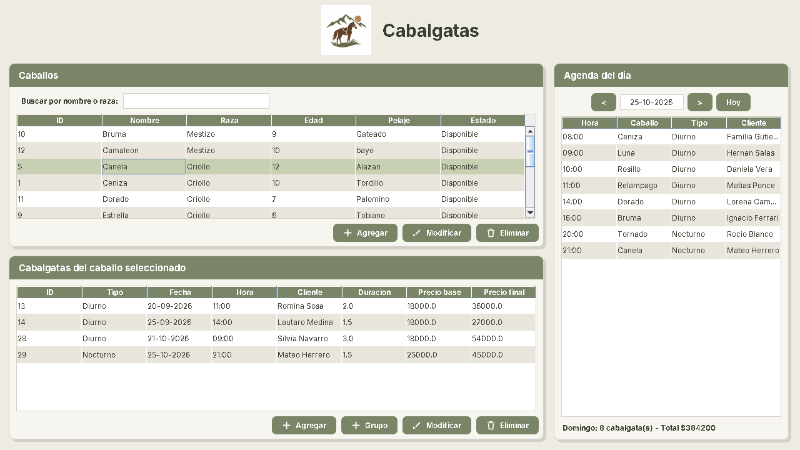
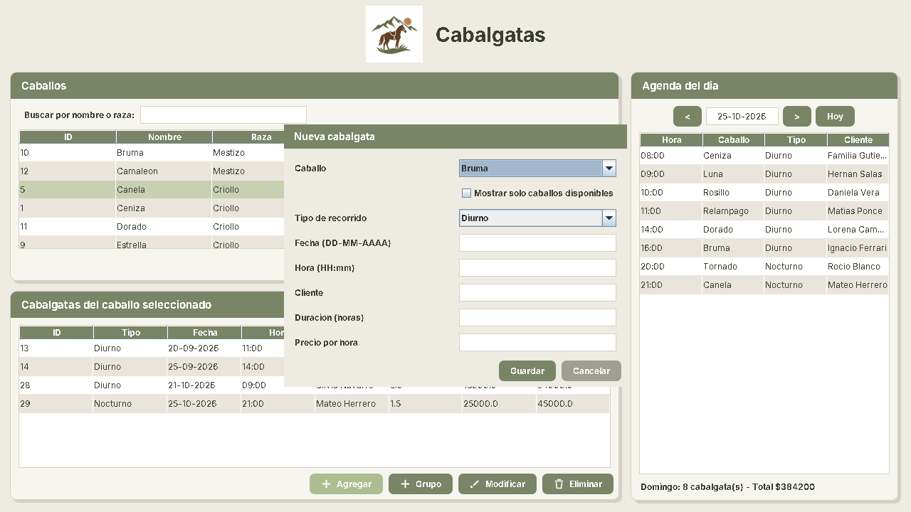
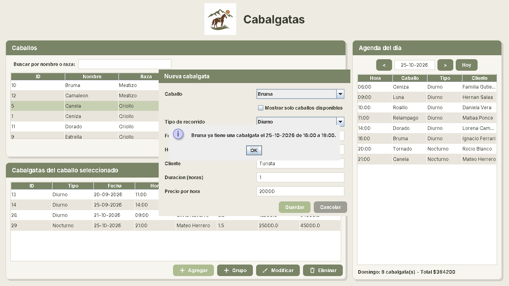

# Cabalgatas — Sistema de gestión de cabalgatas

Aplicación de escritorio en **Java Swing + SQLite** para gestionar los caballos y las salidas (cabalgatas) de una empresa de turismo ecuestre de Mendoza.

Proyecto individual de **Programación III** — Licenciatura en Sistemas de Información, Universidad Champagnat (2026).



## Funcionalidades

- **ABM de caballos**: alta, modificación y baja, con buscador por nombre o raza.
- **Maestro-detalle**: al elegir un caballo se ven todas sus cabalgatas.
- **ABM de cabalgatas** individuales y carga de **grupos** (varios caballos para la misma salida).
- **Agenda del día**: navegación por fecha, con la cantidad de cabalgatas y el total facturado.
- **Validaciones de negocio**: un caballo no puede estar en dos cabalgatas que se superpongan en fecha y hora; formatos de fecha y hora; campos obligatorios.
- **Precio final según el tipo de recorrido** (diurno o nocturno), calculado con polimorfismo.

| Nueva cabalgata | Validación de superposición |
|---|---|
|  |  |

## Tecnologías y conceptos

- **Java** (POO): herencia, encapsulamiento y polimorfismo. `Movimiento` es una clase abstracta con las subclases `MovimientoDiurno` y `MovimientoNocturno`, que redefinen `calcularPrecioFinal()`.
- **Java Swing**: `JFrame`, `JDialog`, `JTable`, `JComboBox`, `JCheckBox` y estilos propios.
- **SQLite + JDBC**: acceso a datos con el patrón **DAO** y `PreparedStatement`.
- **Patrón MVC**: paquetes `modelo`, `vista` y `controlador`, con un controlador por vista.

## Estructura

```
src/
├── cabalgatas/    Clase principal (main)
├── modelo/        Entidades, DAO, conexión y validaciones
├── vista/         Ventanas y diálogos Swing
└── controlador/   Lógica que conecta vistas y modelo
lib/               Driver sqlite-jdbc
```

## Cómo ejecutarlo

1. Abrir el proyecto en **NetBeans** (o cualquier IDE con Java 21 o superior).
2. Verificar que `lib/sqlite-jdbc-3.46.1.3.jar` esté agregado a las librerías del proyecto.
3. Ejecutar `cabalgatas.Cabalgatas`. La base `cabalgatas.db` se crea sola la primera vez.

## Autora

**Mia Nogara** — [LinkedIn](https://linkedin.com/in/mia-nogara) · [GitHub](https://github.com/mianogaraa)
